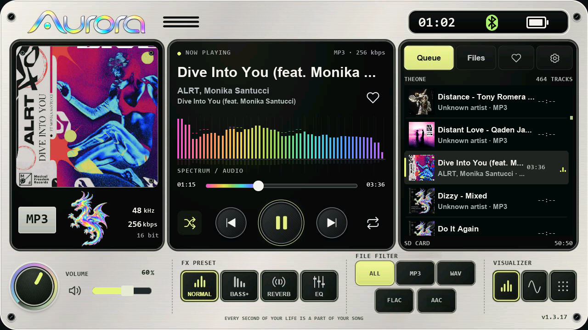
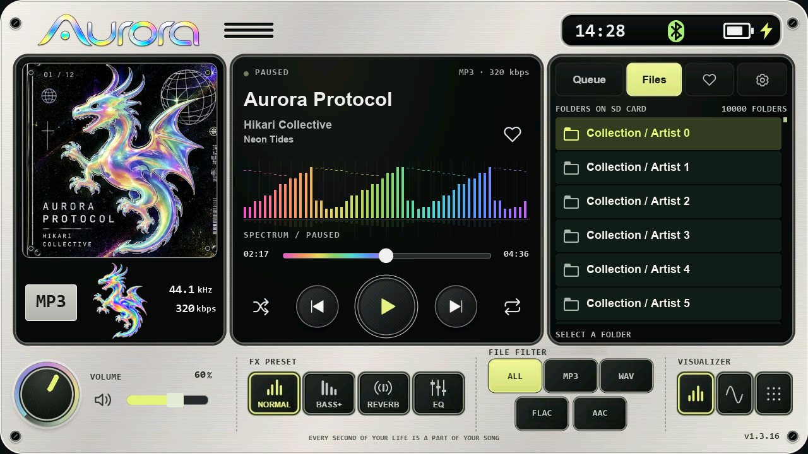
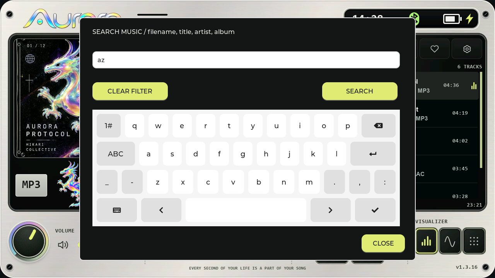
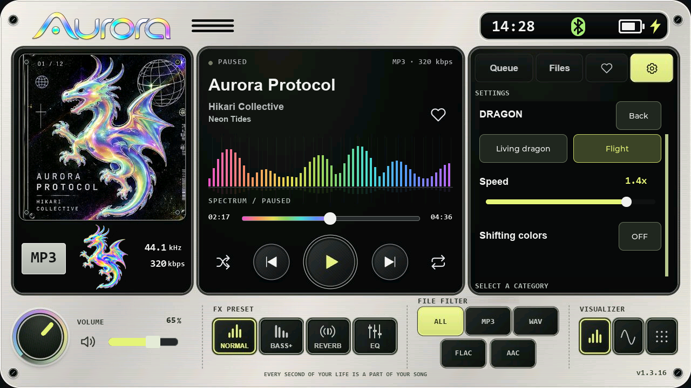
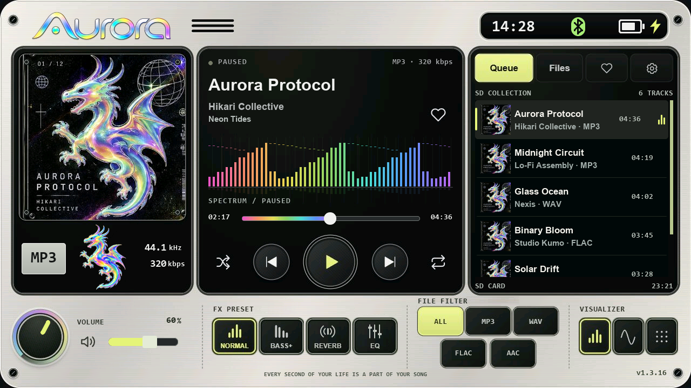
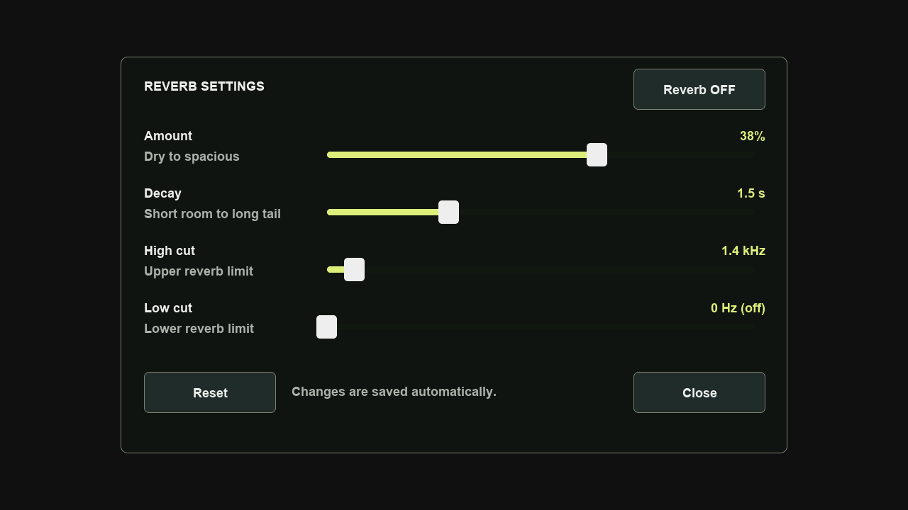

# Aurora Player for the M5Stack Tab5

Aurora Player is a native music player firmware for the
[M5Stack Tab5](https://docs.m5stack.com/en/core/Tab5) (ESP32-P4). It plays music
from the microSD card on the Tab5 itself, with no browser, phone or computer
involved, and draws a full 1280 × 720 interface with an animated dragon and live
visualizers.



*Screenshot taken on the Tab5 with Aurora's built-in screenshot function
(version 1.3.17).*

## Features

- **Playback** of MP3, WAV, FLAC and AAC (ADTS) from `/Music` on the SD card
  (exFAT or FAT32), up to 10,000 tracks, with a saved library index for fast start.
- **Queue, Files (folders) and Favorites** tabs, search with an on-screen
  keyboard, file-type filter (ALL / MP3 / WAV / FLAC / AAC), shuffle and repeat
  (off / all / one), resume where you left off.
- **Sound:** Normal, Bass+, Reverb (with low/high cut) and an 11-band EQ with
  presets; turntable speed 75–125 % (changes pitch); volume knob.
- **Visuals:** Living dragon and Flight animations, spectrum, waveform and
  particle visualizers, cover artwork from tags or the folder.
- **Screen lock** with a 4-digit PIN (stored in its own flash partition),
  frosted or custom lock-screen backgrounds, optional startup artwork.
- **Enclosure tap controls** (1.3.21): with the screen off and the PIN locked,
  3 taps on the frame pause and 2 taps resume, without waking the screen. See
  [docs/TAP-CONTROLS.md](docs/TAP-CONTROLS.md).
- **Hardware:** battery level and charging state, headphone jack detection
  (speaker off when headphones are in), RTC clock.
- **Keyboard:** the optional M5Stack Tab5 Keyboard (A164) controls playback,
  lists, search, settings and the PIN screen (see [Keyboard](#keyboard)).
- **Bluetooth headphones** through an optional M5Stamp Pico (ESP32-PICO-D4)
  wired to the Tab5; its firmware, wiring and guide are in
  [pico-bridge/](pico-bridge/README.md) (see [Bluetooth](#bluetooth-headphones)).

| | |
|---|---|
|  |  |
|  |  |
|  |  |

*These screens are host renders made on a PC with sample data (version 1.3.16
interface); the firmware draws the same screens with LVGL on the device.*

## Keyboard

Plug the M5Stack Tab5 Keyboard (A164) into **Ext.Port1**; Aurora finds it by
itself, also when it is attached later. On the main screen:

| Key | Action |
|---|---|
| Space | Play / pause |
| Ctrl + ← / Ctrl + → | Previous / next track (more than 3 s into a track, Ctrl + ← restarts it) |
| ← / → | Seek 5 s back / forward (hold to keep seeking) |
| Ctrl + ↑ / Ctrl + ↓ | Volume +5 / −5, also for Bluetooth headphones |
| Ctrl + M | Mute on / off |
| Tab | Next library tab: Queue → Files → Favorites |
| ↑ / ↓ | Move the highlight in the list |
| Enter | Play the highlighted track, or open the highlighted folder |
| Esc | Remove the highlight |
| Letter, digit or symbol | Open Search with that character |
| Ctrl + F | Open Search with the current query |
| Ctrl + , | Open Settings |
| Ctrl + B | Open the Bluetooth window |

- **Search:** type the query, Backspace / Delete edit, ← / → move the cursor,
  Enter applies it, Esc closes without applying, Ctrl + U clears the text.
- **Settings and dialogs:** ↑ / ↓ or Tab move between controls, ← / → change a
  slider, Enter presses, Esc goes back or closes. In dialogs the first Enter only
  shows the highlight. Enter on *Power off* shuts down at once.
- **PIN screen:** digits 0–9 enter the PIN (the 4th digit is checked at once),
  Backspace deletes a digit, Esc cancels when setting or changing the PIN.
- **Screen off:** any key turns the screen on and does nothing else; Aa, Sym,
  Ctrl or Alt alone do not.
- Letters, digits, Space, Backspace / Delete and the arrows repeat when held
  (typing in Search, moving the highlight, seeking). Holding Space does not
  repeat Play / pause, and nothing repeats on the PIN screen. Enter, Esc, Tab
  and Ctrl or Alt combinations never repeat. Alt blocks shortcuts and typing,
  except that Alt + Esc still closes Search and dialogs and Alt + Enter still
  applies Search.

Every key and context is listed in [docs/KEYBOARD.md](docs/KEYBOARD.md).

## Bluetooth headphones

The Tab5's own radio cannot send audio to Bluetooth headphones, so Aurora uses
an **M5Stamp Pico** (ESP32-PICO-D4) as a Bluetooth transmitter: seven wires to
the Tab5 (power, ground, three I2S audio lines and two UART lines), the Pico
Bluetooth 0.9.5 firmware from the release, and the Bluetooth window in Aurora
(top-bar Bluetooth button or Ctrl + B) to scan, pair and switch headphones.
AirPods also get battery, ear detection and listening-mode controls. The
wiring, flashing, usage and troubleshooting guide is in
[pico-bridge/README.md](pico-bridge/README.md).

## Requirements

- M5Stack Tab5. Developed and tested on a Tab5 with the ST7121 display and
  ST7123 touch controller (board version 3); other revisions are untested.
- A microSD card (exFAT or FAT32) with your music in `/Music`. Aurora keeps its
  settings, cache, screenshots and lock-screen images in `/Aurora` on the card
  (see [docs/SD-STORAGE.md](docs/SD-STORAGE.md)).
- Optional: the M5Stack Tab5 Keyboard (A164); an M5Stamp Pico for Bluetooth
  headphones.

## Install

Download the files from the
[latest release](https://github.com/UNIZERSION/aurora-player/releases/latest) and
flash them with [esptool](https://github.com/espressif/esptool) 4.x (tested with
`python -m pip install esptool==4.12.0`). Connect the Tab5 by USB-C; replace
`COM4` with your port (`/dev/ttyACM0` on Linux, `/dev/cu.usbmodem…` on macOS).
The prebuilt images are built for ESP32-P4 chips below revision 3.0 (the
tested Tab5 has revision 1.3); esptool checks the chip revision and refuses an
incompatible chip. For a revision 3 chip, build from source with the matching
ESP-IDF setting.

**New install** (bootloader, partition table and app in one file, written at 0x0):

```
python -m esptool --chip esp32p4 --port COM4 --baud 921600 write_flash 0x0 Aurora-Player-1.3.21-Standalone.bin
```

This replaces the partition table, so it removes other firmware on the Tab5
(for example a launcher). Music and settings on the SD card are not touched.

**Update** an existing Aurora install (app only, written at 0x10000):

```
python -m esptool --chip esp32p4 --port COM4 --baud 921600 write_flash 0x10000 Aurora-Player-1.3.21-Application.bin
```

Updates keep the partition layout, the PIN and the settings. The Application
image also works as an app for Tab5 launchers that install into a flash slot.
In that case the PIN lock needs the flash region 0xF10000–0xF15FFF
(`aurora_cfg`) to be free or already used by Aurora: if another partition of the
launcher overlaps it, the PIN lock reports a storage error instead of working,
and the tap controls, which act only while the PIN lock is active, are
unavailable too. Aurora never erases that region on its own.

Partition layout: `nvs` 0x9000, `phy_init` 0xF000, `factory` app 0x10000
(15 MiB), `aurora_cfg` 0xF10000 (PIN storage). Check the SHA-256 of a download
against `SHA256SUMS.txt` in the release.

The release also has the Bluetooth bridge firmware for the M5Stamp Pico
(`Pico-Bluetooth-0.9.5-Standalone.bin` and `-Application.bin`); it is flashed
to the Pico, not to the Tab5 (see [pico-bridge/README.md](pico-bridge/README.md#flashing-the-pico)).

## Build from source

1. Install [ESP-IDF 5.5.2](https://docs.espressif.com/projects/esp-idf/en/v5.5.2/esp32p4/get-started/)
   with the ESP32-P4 target and open an ESP-IDF terminal.
2. Build: `idf.py build` (the ESP-IDF component manager downloads the pinned
   dependencies from [dependencies.lock](dependencies.lock): M5Stack Tab5 BSP
   1.3.2, esp_lvgl_port 2.8.0, LVGL 9.3.0, esp_audio_codec 2.5.0).
3. Flash: `idf.py -p COM4 flash`, or the app only: `idf.py -p COM4 app-flash`.

Build options (pass with `-D` to `idf.py`; use a separate build folder so the
normal build is not reconfigured, for example
`idf.py -B build-calib -DAURORA_TAP_STREAM=1 build`):

- `AURORA_TAP_CONTROLS=0` builds without enclosure tap controls.
- `AURORA_TAP_STREAM=1` builds the calibration firmware that streams every motion
  sample over USB (see [tools/tap-eval](tools/tap-eval/README.md)).

`python tools/package_firmware.py --build build` packages a build as
`tab5_player.bin` (app, 0x10000) and `tab5-player-merged.bin` (complete image,
0x0) with a SHA-256 manifest; the release files are the same images renamed
`Aurora-Player-<version>-Application.bin` and `-Standalone.bin`.

The embedded artwork, fonts and lookup tables are already generated, so a
normal build needs none of the generators. The scripts in [tools/](tools)
regenerate them from the reference design in
[tools/aurora-reference](tools/aurora-reference); they need Python 3 with Pillow,
[lv_font_conv](https://github.com/lvgl/lv_font_conv) 1.5.3 for the Montserrat
Latin set, and the Windows fonts Arial Bold and Consolas Bold for the interface
fonts (see [licenses/NOTICE.md](licenses/NOTICE.md)).

## Tests on a PC

The `tests/` folder holds host tests that compile the real firmware sources
with stubs for the hardware: audio engine, EQ and reverb, library and storage,
screen lock, UI rendering with LVGL, keyboard, Bluetooth protocol, tap detector
and more. They run on Windows with PowerShell and need
[Zig 0.13.0](https://ziglang.org/download/) (used as the C/C++ compiler) and
Python 3 with Pillow. The tests compile LVGL from `managed_components/`, and the
exFAT suite uses the configured firmware build in `build/`, so run
`idf.py build` (or at least `idf.py reconfigure`) with ESP-IDF 5.5.2 once before
the first test run. Then:

```
powershell -NoProfile -ExecutionPolicy Bypass -File tests\run_all_tests.ps1
```

Options: `-Only tap_gesture,core` runs selected suites; `-Zig <path>` and
`-Python <path>` select the tools when they are not on `PATH`. Each suite can
also be run alone with its `tests\run_*` script. Note: Zig defines `NDEBUG` at
`-O1`/`-O2`, so every C/C++ test includes `#undef NDEBUG` (directly or via its
`*_host.h` stub) to keep its `assert()` checks.

## Documentation

- [CHANGELOG.md](CHANGELOG.md) — changes per version.
- [docs/AURORA-PORT.md](docs/AURORA-PORT.md) — how the Aurora design was ported to LVGL.
- [docs/platform.md](docs/platform.md) — Tab5 hardware integration.
- [docs/SCREEN_LOCK.md](docs/SCREEN_LOCK.md), [docs/TAP-CONTROLS.md](docs/TAP-CONTROLS.md),
  [docs/SD-STORAGE.md](docs/SD-STORAGE.md), [docs/EQUALIZER-1.3.11.md](docs/EQUALIZER-1.3.11.md),
  [docs/REVERB_SETTINGS.md](docs/REVERB_SETTINGS.md), [docs/KEYBOARD.md](docs/KEYBOARD.md),
  [docs/AIRPODS_CONTROLS.md](docs/AIRPODS_CONTROLS.md) — features in detail.
- [pico-bridge/README.md](pico-bridge/README.md) — Bluetooth bridge: wiring, flashing, usage,
  protocol; [pico-bridge/CHANGELOG.md](pico-bridge/CHANGELOG.md) — its versions.
- [docs/AUDIT-1.3.18.md](docs/AUDIT-1.3.18.md) — code audit of 1.3.18 and what was fixed afterwards.

## Authors

Created by **UNIZERSION**, with **GPT (OpenAI Codex)**, which built the
foundations of the firmware and the Pico Bluetooth bridge, and **Claude
(Anthropic)**, which did the 1.3.18 audit, the fixes in 1.3.19–1.3.20 and the
tap detector of 1.3.21. Details in [NOTICE.md](NOTICE.md).

## License

GPL-3.0-only with an additional permission to link with Espressif's ESP-IDF
and libraries such as `esp_audio_codec` (see [LICENSE](LICENSE) and
[NOTICE.md](NOTICE.md)). Third-party components keep their own licenses, listed
in [licenses/NOTICE.md](licenses/NOTICE.md). The interface fonts in
`main/aurora_fonts.c` and `main/aurora_fx_label12.h` are rasterized from
Microsoft's Arial Bold and Consolas Bold and are not covered by the GPL; see
[NOTICE.md](NOTICE.md) before redistributing them. The Pico bridge includes a
modified copy of ESP32-A2DP under the Apache License 2.0
([pico-bridge/lib/ESP32-A2DP](pico-bridge/lib/ESP32-A2DP/MODIFICATIONS.md)).
